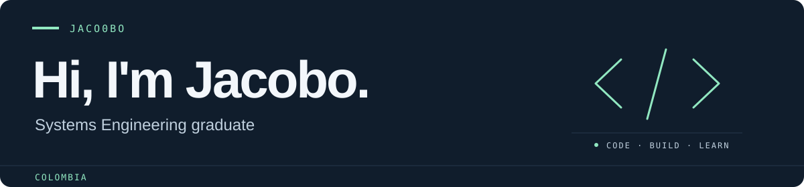

  

I'm **Jacobo**, a **Systems Engineering graduate from Colombia**. This is where I share my projects, experiments, and learning through code.

  <a href="https://www.linkedin.com/in/andr%C3%A9s-jacobo-sep%C3%BAlveda-s%C3%A1nchez-908430251/">LinkedIn ↗</a>
  &nbsp; · &nbsp;
  <a href="https://github.com/Jaco0bo?tab=repositories">Explore my repositories ↗</a>

## Technologies

**Languages**

  
  &nbsp;
  
  &nbsp;
  
  &nbsp;
  
  &nbsp;
  
  &nbsp;
  
  &nbsp;
  

**Web development**

  
  &nbsp;
  
  &nbsp;
  
  &nbsp;
  

**Backend & databases**

  
  &nbsp;
  
  &nbsp;
  
  &nbsp;
  

**Cloud & tools**

  
  &nbsp;
  
  &nbsp;
  
  &nbsp;
  
  &nbsp;
  

## GitHub activity

  

  
Contribution stats & languages

   
  

    
    
  

  

    
  

  
A little personality

   
  

